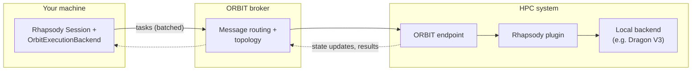
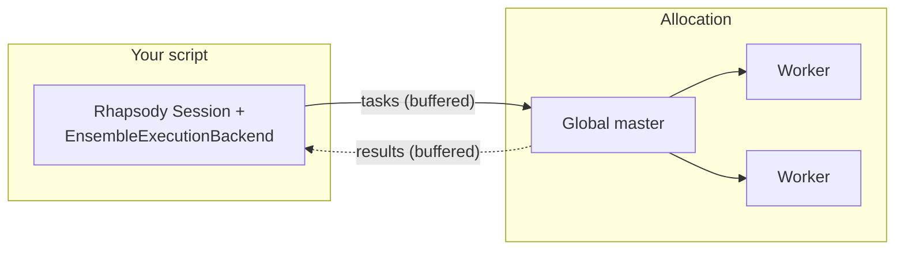

# Configuration

RHAPSODY uses a flexible configuration system for its session and backends.

## Session Configuration

The `Session` object is primarily configured through its constructor:

| Parameter | Type | Default | Description |
|-----------|------|---------|-------------|
| `backends` | `list` | `None` | List of initialized backend objects. |
| `uid` | `str` | `None` | Unique ID for the session (generated if None). |
| `work_dir` | `str` | `None` | Working directory for task files (defaults to CWD). |

## Backend Configuration

Each backend has its own set of parameters.

### Concurrent Backend
Local execution using Python's `concurrent.futures`.

```python
from concurrent.futures import ThreadPoolExecutor
from rhapsody.backends import ConcurrentExecutionBackend

# Default uses ThreadPoolExecutor
backend = ConcurrentExecutionBackend(name="local")

# Or provide a custom executor
executor = ThreadPoolExecutor(max_workers=8)
backend = ConcurrentExecutionBackend(name="local", executor=executor)
```

### Dask Backend
Distributed execution using any Dask-compatible cluster.

```python
DaskExecutionBackend(
    resources={"n_workers": 4, "memory_limit": "2GB"},  # passed to LocalCluster when no cluster/client given
    cluster=pre_existing_cluster_obj,  # SLURMCluster, KubeCluster, LocalCluster, …
    client=pre_existing_client_obj     # pre-existing dask.distributed.Client
)
```

Supports **sync functions**, **async functions**, and **executable tasks**. Pass Dask-specific scheduling hints via `task_backend_specific_kwargs`:

```python
ComputeTask(
    function=my_fn, args=(x,),
    task_backend_specific_kwargs={"resources": {"GPU": 1}},  # GPU worker only
)
ComputeTask(
    executable="/bin/sim", arguments=["--n", "4"],
    task_backend_specific_kwargs={"resources": {"CPU": 4}, "shell": True},
)
```

!!! tip "Preconfigured Clusters"
    If both `cluster` and `client` are omitted, Rhapsody creates a new `LocalCluster` using the provided `resources`. Pass `cluster=` to use SLURM, Kubernetes, or any other Dask cluster type — construct it with `asynchronous=True` (entered via `async with`); see [Cluster injection](advanced-usage.md#cluster-injection) for why this matters and a full example.

### Dragon Backend
High-performance execution using the Dragon runtime. Scripts that use it must be started with the
`dragon` launcher (`dragon my_script.py`).

```python
import multiprocessing as mp
from rhapsody.backends import DragonExecutionBackend

mp.set_start_method("dragon")
backend = await DragonExecutionBackend(
    batch_kwargs={"num_nodes": 4},  # forwarded to dragon.workflows.batch.Batch (optional)
    pmi="pmix",                     # default PMI for MPI jobs (optional)
    name="dragon",
)
```

| Parameter | Type | Default | Description |
|-----------|------|---------|-------------|
| `batch_kwargs` | `dict` | `None` | Forwarded to `dragon.workflows.batch.Batch(...)`, e.g. `num_nodes`, `scheduler_workers`, `results_ddict_mem`, `disable_telem`, `task_logs`. See [Backend-level configuration](resource-specification.md#backend-level-configuration-batch_kwargs). |
| `name` | `str` | `"dragon"` | Backend identifier used for task routing |
| `pmi` | `str` or `PMIBackend` | `None` | PMI for multi-rank (`process_templates`) jobs: `"pmix"`, `"cray"` or `"none"`; a task's own `pmi` takes precedence. See [MPI jobs: PMI and timeout](resource-specification.md#mpi-jobs-pmi-and-timeout). |

!!! note "Streaming pipeline"
    `DragonExecutionBackend` uses Dragon's streaming batch pipeline — tasks submitted via
    `session.submit_tasks()` are dispatched individually by a continuously running background
    thread. There is no compile or start step; tasks begin executing as soon as they are submitted.

!!! note "Dragon Versions"
    `DragonExecutionBackend` is the only supported Dragon backend as of RHAPSODY 0.5.0.

### Orbit Backend
Remote execution on an HPC system through the ORBIT broker/endpoint infrastructure.

[ORBIT](https://github.com/radical-cybertools/radical.orbit) is a lightweight
communication fabric for reaching compute resources that are not directly
accessible from where your application runs (e.g. behind an HPC login node or
firewall). Both your application and the remote resource connect *outbound* to
a shared **broker**, which routes messages between them. On the remote side, an
**endpoint** process runs on the HPC system and exposes plugins — one of which
is a Rhapsody plugin hosting a local execution backend (Dragon V3 by default)
that actually runs your tasks. The `OrbitExecutionBackend` connects to the
broker, discovers a suitable endpoint from the live topology, and from then on
behaves like any other Rhapsody backend: tasks submitted to the local session
are batched, shipped to the remote endpoint, executed there, and their results
and state updates streamed back via notifications.



```python
from rhapsody.backends import OrbitExecutionBackend

backend = await OrbitExecutionBackend(
    broker_url="https://broker.example.org:8000",
    endpoint_name="frontier_ep",   # optional — auto-selected if omitted
    backends=["dragon_v3"],        # backend(s) to run on the remote endpoint
)
```

| Parameter | Type | Default | Description |
|-----------|------|---------|-------------|
| `broker_url` | `str` | `None` | ORBIT broker URL; falls back to `RADICAL_ORBIT_BROKER_URL` or `~/.radical/orbit/broker.url` |
| `endpoint_name` | `str` | `None` | Endpoint to target; auto-selects the first live endpoint advertising a Rhapsody plugin if omitted |
| `backends` | `list` | `["dragon_v3"]` | Backend names to start in the remote session |
| `name` | `str` | `"orbit"` | Backend identifier used for task routing |
| `batch_window` | `float` | `0.25` | Seconds to collect tasks before flushing as one bulk request; `0` disables batching |
| `batch_limit` | `int` | `1024` | Max tasks per batch — triggers an immediate flush when reached |
| `start_timeout` | `float` | `30` | Seconds to wait for broker registration |
| `init_timeout` | `float` | `120` | Seconds to wait for the remote session to become ready |

The broker bearer token is resolved the same way as the URL, from
`RADICAL_ORBIT_BROKER_TOKEN` or `~/.radical/orbit/broker.token`.

!!! note "Submission batching"
    Tasks submitted individually are collected over a short time window and
    flushed as a single bulk request, which drastically reduces per-task
    round-trip overhead. Bulk submissions and transport-level optimizations
    (template compression, pipelined batching, event-based waiting) are
    inherited from the ORBIT client.

!!! warning "Function tasks require matching Python versions"
    Function tasks are shipped with `cloudpickle`, which is not portable
    across Python *minor* versions — the client and the remote endpoint must
    run the same `major.minor` Python (the backend checks this and fails
    fast on a mismatch). Executable and import-path tasks are unaffected.
    The `orbit` extra itself requires Python >= 3.10.

### Ensemble Launcher Backend
Hierarchical task execution on HPC systems using [Ensemble Launcher](https://github.com/argonne-lcf/ensemble_launcher) (EL).

EL starts a tree of orchestrator processes across the allocation: a global
**master** at the root, optional intermediate masters, and **workers** at the
leaves that execute tasks. The `EnsembleExecutionBackend` starts this tree,
connects to its root with a `ClusterClient`, and from then on behaves like any
other Rhapsody backend: tasks are buffered on the client, routed down the tree,
executed by the workers, and their results buffered and sent back. Function
tasks run in a process pool on the workers; executable tasks are launched with
the configured MPI launcher.



```python
from rhapsody.backends import EnsembleExecutionBackend

backend = await EnsembleExecutionBackend(
    mpi_flavour="mpich",   # MPI launcher used for executable tasks
    nlevels=1,             # one level of workers below the global master
    nleafs=4,              # number of worker processes
    buffer_size=1000,      # task and result buffer size
    flush_interval=0.001,  # task and result flush interval in seconds
)
```

| Parameter | Type | Default | Description |
|-----------|------|---------|-------------|
| `name` | `str` | `None` | Backend identifier used for task routing |
| `mpi_flavour` | `str` | `"mpich"` | MPI launcher for executable tasks: `"mpich"`, `"intel"`, `"openmpi"`, `"cray-pals"`, `"srun"`, `"aprun"`, `"jsrun"` or `"test"` (plain `mpirun -np`, no host or binding flags) |
| `mpi_config` | `MPIConfig` | `None` | Full EL `MPIConfig`; overrides `mpi_flavour` |
| `nlevels` | `int` | `0` | Number of levels in the orchestrator tree below the global master |
| `nleafs` | `int` | `None` | Number of workers at the leaves; defaults to the number of nodes. Must be a multiple of the number of nodes when larger |
| `buffer_size` | `int` | `100000` | Tasks (client side) and results (worker side) buffered before an early flush; `0` sends every task and result on its own |
| `flush_interval` | `float` | `0.05` | Seconds between task and result buffer flushes; bounds the per-task latency |
| `req_res` | `bool` | `True` | ACK-based guaranteed delivery of tasks and results |
| `hosts` | `list[str]` | `None` | Hosts to launch on; defaults to `$PBS_NODEFILE`, or the local host |
| `cpus` | `list[int]` | `None` | CPU IDs available to tasks on each node; defaults to all CPUs |
| `gpus` | `list[int]` | `None` | GPU IDs available to tasks on each node |
| `gpu_selector` | `str` | `"ZE_AFFINITY_MASK"` | Environment variable set to select a task's GPUs (e.g. `"CUDA_VISIBLE_DEVICES"`) |
| `children_scheduler_policy` | `str` | `"fixed_leafs_children_policy"` | EL policy that splits nodes between children |
| `task_scheduler_policy` | `str` | `"large_resource_policy"` | EL policy that places tasks on resources |
| `enable_workstealing` | `bool` | `False` | Let idle workers steal tasks from busy ones |
| `return_stdout` | `bool` | `True` | Capture and return the stdout of executable tasks |
| `master_logs` / `worker_logs` | `bool` | `True` | Write EL master and worker logs |
| `checkpoint_dir` | `str` | `None` | Directory for EL checkpoints and logs; defaults to `./ckpt_<uuid>` |
| `client_only` | `bool` | `False` | Connect to an EL cluster that is already running instead of starting one |
| `node_id` | `str` | `"global"` | Orchestrator node the client connects to |

!!! tip "Tuning throughput"
    Every task waits up to `flush_interval` in the client buffer and its result up
    to `flush_interval` in the worker buffer, so lower it for latency-sensitive
    workloads. `buffer_size=0` disables buffering and lowers throughput
    considerably; any buffer of a few hundred tasks is enough for high throughput.
    Adding workers with `nleafs` raises the throughput of a single node.

!!! note "Connecting to a running cluster"
    With `client_only=True` the backend does not start EL; it connects to the
    cluster whose checkpoints are in `checkpoint_dir`. Use `node_id` to submit to a
    specific orchestrator node (`"main"`, `"main.w0"`, ...) instead of the global
    master.

### RADICAL-Pilot Backend
Large-scale HPC execution using RADICAL-Pilot.

```python
RadicalExecutionBackend(
    resources={
        "resource": "local.localhost",
        "runtime": 30, # minutes
        "cores": 128
    }
)
```

## Logging and Working Directory

Enable RHAPSODY's logging programmatically, before creating backends:

```python
import logging
from rhapsody import enable_logging

enable_logging(level=logging.DEBUG)
```

Task files (for example `capture_stdio` output) go under `<work_dir>/<session uid>/`; set the
base directory with `Session(work_dir=...)` (default: the current directory).
